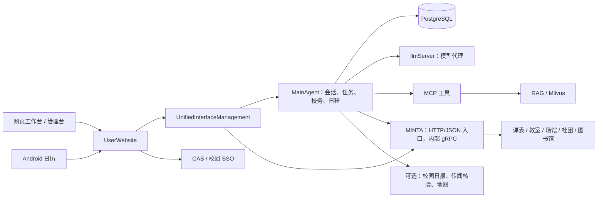

# Campus Desk Agent · 校园服务助手

Campus Desk Agent 把校园问答、资料检索和校务办理接到同一个工作台。学生和教师可以通过网页聊天、查询课表、管理个人日程；管理员负责账号、校园身份、业务开放规则和受管进程。仓库提供源码、表结构、迁移、配置模板和测试。新部署从空库开始。



Windows 下可由 [MainProcessManager](MainProcessManager/README.md) 统一管理进程、账号和服务依赖。也可按模块分别启动。

| 模块 | 源码位置 | 本机默认端口 |
| --- | --- | --- |
| 用户网站、管理台、Android 下载 | [UserWebsite](server/UserWebsite/)、[UIF](client/UIF/)、[Admin](client/Admin/)、[AndroidAppServer](server/AndroidAppServer/) | 网站 8082；下载 8186 |
| 统一入口与内部权限检查 | [UnifiedInterfaceManagement](server/UnifiedInterfaceManagement/) | 8090 |
| 多用户 Agent、四类校园子智能体、独立 Worker | [MainAgent](server/MainAgent/) | 8081 |
| 模型转发、工具、资料检索 | [llmServer](server/llmServer/)、[mcpServer](server/mcpServer/)、[RAG](DataBase/RAG/) | 8000、8001、8002 |
| 校园登录与教师凭据 | [CASserver](server/CASserver/)、[TeacherCredentials](DataBase/TeacherCredentials/) | CAS 8193；凭据 8192 |
| 校务模拟和 MINTA 路由 | [simulation](simulation/) | HTTP 网关 19000；五个后端 19001–19005；内部 gRPC 19101–19105 |
| 日报与传闻接入 | [CampusDigest](server/CampusDigest/)、[CampusRumor](server/CampusRumor/) | 8184、8100 |

## 先看网页

需要 Node.js 24+。在**新克隆**中运行下列命令即可查看主页和健康接口。预览使用 18082，统一接口指向独立的开发端口 18090。登录和校务功能需连上自己的后端。

```powershell
git clone https://github.com/FIRENESST/Campus-Desk-Agent.git
Set-Location Campus-Desk-Agent
$env:USER_WEB_PORT = '18082'
$env:USER_WEB_PUBLIC_URL = 'http://127.0.0.1:18082'
$env:USER_WEB_UIM_URL = 'http://127.0.0.1:18090'
node server/UserWebsite/server.mjs
```

在浏览器打开 `http://127.0.0.1:18082/`；`/health` 检查网页进程。

## 启动完整开发环境

以下是 Windows 配置方式。使用独立机器、虚拟机或确认端口不冲突的环境；数据库、状态目录和本机配置分别新建。准备 Python 3.14、Node.js 24+、PostgreSQL 17+、JDK 21+、.NET 10 SDK 和 Rust 稳定工具链，其中后三项用于校务模拟。

1. 分别在 `server/llmServer`、`server/MainAgent`、`server/mcpServer`、`server/UnifiedInterfaceManagement`、`server/CASserver`、`DataBase/RAG` 创建对应的虚拟环境。每个目录运行 `py -3.14 -m venv .venv` 和 `.\.venv\Scripts\python.exe -m pip install -r requirements.txt`，MainAgent 使用 `requirements-cloud.txt`。体育馆模拟另需在 `simulation/Gymnasium` 安装其依赖。
2. 按 [PostgreSQL 空库初始化](DataBase/PostgreSQL/README.md) 建库并应用全部迁移。参考 `server/MainAgent/.env.cloud.example`、各服务的 `.env.example` 创建本机配置，填入新的数据库连接、模型地址和 API Key。需要邮箱认证或校园 SSO 时配置自己的 SMTP / IdP。RAG 按 [说明](DataBase/RAG/README.md) 下载模型并初始化空集合。
3. 如需校务模拟，按 [模拟后端准备步骤](simulation/README.md) 构建五个后端和 MlNTA 网关。数据源由部署者自行提供。需要校历与学期报告时填入独立学期配置。
4. 新终端切回项目根目录。初始化本机管理账号，进入控制台后输入 `start core`、`start user-website`；启用模拟时再输入 `start mintagw`。需要本地 CAS 管理员时，先用 `cas admin passwd` 设置密码。通过 `status` 观察状态。页面地址是 `http://127.0.0.1:8082/`。

```powershell
py -3.14 -B -m MainProcessManager init
py -3.14 -B -m MainProcessManager run
```

校园日报、传闻核验需要独立交付的运行包，见各自接入说明；未安装时主管理器跳过它们。Android 下载服务在加入自行构建和签名的 APK 后提供下载，详见 [Android 构建说明](client/AndroidCalendar/README.md)。

## 数据与凭据放在哪里

发布仓库不含账号、对话、预约记录、资料正文、向量库、地图、采集缓存、签名、密钥、模型或运行产物。数据库只保留结构和迁移；模拟服务默认空数据。各模块的测试只创建虚构记录，应用启动时不会加载这些测试夹具。

- 数据放在仓库外或被忽略的 `local-data/`，用环境变量指定路径；地图格式见 [CampusNavigation](DataBase/CampusNavigation/README.md)。
- 本机配置使用 `.env`、`.env.cloud`，复用模板时只替换自己的值。主管理器首次运行会在本机状态目录创建数据库，教师凭据、CAS、日报和模拟服务也会各自创建自己的空存储。
- 头像可使用静态标识；Live2D 运行素材、模型、场景媒体和安装包由部署者自行提供。公开接口仍保留可选资源路径。

## 验证

网页运行 `node --test server/UserWebsite/test/*.test.mjs`。Python 服务在各自目录安装依赖后运行 `python -B -m unittest discover -s tests -q`；CAS 测试使用 `requirements-test.txt`。课表用 `cargo test --locked`，教室用 `dotnet run --project Classroom.Tests`，图书馆用 `.\test.ps1`，社团用 `npm ci && npm test`。MainAgent 的 PostgreSQL 集成测试需显式启用 `CLOUD_TEST_POSTGRES=1`，它创建临时数据库集群。

项目许可证见 [LICENSE](LICENSE)。自带第三方 JavaScript 的许可随 [Markdown 渲染器](client/UIF/vendor/) 和 [二维码组件](server/AndroidAppServer/vendor/) 保留。
