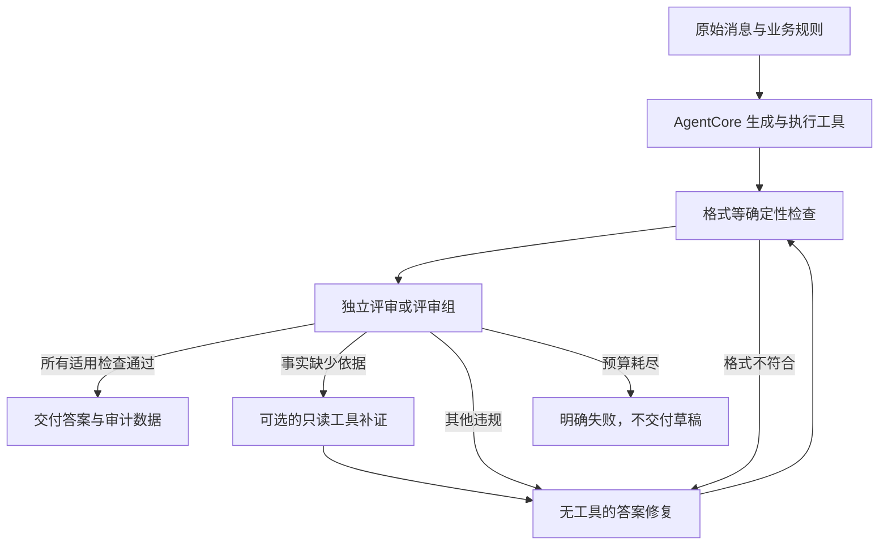

# MainAgent 与可信性编排

MainAgent 提供异步 `AgentCore`、OpenAI 兼容模型适配器，以及 MCP、REST、GraphQL、WebSocket 工具适配器和 MINTA 网关客户端。

校园子智能体框架位于 `main_agent/campus_cluster`，包含校园介绍、信息搜寻、校园服务和谣言判别四个角色。技能在 `subskills/registry.py` 统一登记，各角色使用其中分配给自己的技能。默认模型路由使用可编辑的角色介绍，可以由服务器本机管理员开启反馈学习。 [框架与技能接入说明](main_agent/campus_cluster/README.md) · [本机路由反馈](main_agent/cloud/README.md#本机路由反馈)

明确的校园传闻或异常变动会交给谣言判别。该子智能体调用 `assess_campus_rumor`，并复用在线管理台保存的官方证据。 [谣言防控服务接入](../CampusRumor/README.md)

## 启动模型服务与 MainAgent

先在 `server/llmServer` 运行 `.\.venv\Scripts\python.exe server.py`，再在本目录按云端说明启动 MainAgent。MainAgent 云 API 默认使用 `8081`，模型服务的端口以其 `.env` 中的 `LOCAL_PORT` 为准。 [llmServer 启动说明](../llmServer/README.md) · [MainAgent 云端启动说明](main_agent/cloud/README.md#启动)

云端默认让主流程的模型路由、四个子智能体的生成、评审和修复共用 `llmServer`。同一工作区会读取其本地端口和本地访问密钥，模型由 `llmServer` 的 `LLM_MODEL` 统一决定。分别部署时可用 `MAIN_AGENT_LLM_SERVER_URL` 和 `MAIN_AGENT_LLM_SERVER_API_KEY` 指定模型服务地址及本地密钥。自定义异步接入也可通过 `connect_llm_server()` 取得同一连接。

连接池由同一进程复用。每个会话的历史从数据库分别加载，每次运行单独创建路由、子智能体和核验上下文。

统一入口可通过 HTTP 或本地 STDIO 访问云 API 和校园街景。外部客户端使用原有 `/v1` 路径，管理入口位于 `/admin`。 [统一接口管理器](../UnifiedInterfaceManagement/README.md)

由本机主管理器启动的 MainAgent 可以把统一入口的 `main.py local` 作为 STDIO 子进程，直接提交实际业务请求。统一入口会在每次转发前通过本机命名管道请主管理器校验调用进程的身份。 [本机逐次鉴权](../../MainProcessManager/README.md#逐次请求鉴权)

主流程可通过 `connect_main_agent_mcp()` 调用本机 MCP 服务。`get_subagent_capabilities` 返回启动时盘点的子智能体职责和技能分配。校园问题在选角前自动读取该清单，由 MainAgent 决定直接处理、澄清或委派，并组织最终答复。`search_rag` 检索指定范围的资料，`read_domain_page` 读取公开域名的 HTTPS 首页，`ocr_document` 识别图片和扫描 PDF。 [MCP 启动和调用说明](../mcpServer/README.md)

四个角色各自登记了 `minta_gateway`，可以查询健身房、社团、图书馆、教室和课表模拟服务。 [MINTA 技能调用](main_agent/campus_cluster/README.md#minta-网关查询)

## MainAgent 人设

在 `MAIN_AGENT_PERSONA` 中编辑主智能体的性格和表达方式。校园回答、通用回答和简单问候或自我介绍都使用这份提示。简单问候和自我介绍最多等待模型 10 秒，超时或模型无法正常回答时使用固定文案。修改后重启 MainAgent，部署了独立 Worker 时也重启 Worker。 [人格提示词](main_agent/cloud/persona.py)

## 可信性编排

新增的 `main_agent.reliability` 是独立、可选的编排模块。它复用现有 `LLMClient` 和 `ToolClient` 接口，不改变模型权重，不引入新的运行依赖。已有的 `AgentCore.run()` 调用方式保持可用。

每次 `ReliableAgent.run()` 都拥有独立的 `RunRuntime`，统一管理阶段状态、调用预算、证据台账、工具执行记录和失败快照。各阶段通过同一个会话计数，多个请求之间不共享可变运行状态。

## 工作流程



- 原始 system/developer 消息原样保留。显式 `Rule` 用于补充可逐条检查的业务约束，不自动改写或压缩原始规则。
- 所有事实声明都需要评审器给出证据 ID 和逐字引用；程序核对 ID 是否存在、引用是否来自原文。操作完成声明还必须有明确的成功工具回执。
- 评审检查指令遵从、事实覆盖和任务完成度。意见和清楚标明的假设不要求伪装成已有事实。
- 工具执行前先整批检查工具名、标准 JSON 参数、业务 guard 和调用额度；任何预检失败都会阻止该批开始执行。`AgentCore` 的可选 `before_tool_batch` 钩子用于接入这项能力。
- 工具结果记录真实 `call_id` 与 `arguments_json`，帮助核对操作对象。修复只重写答案，工具不会因重跑生成流程而再次执行。
- 可选补证器只能访问业务侧指定的查询工具；它自己的总结不会进入证据库。
- 每次修复重新运行全部检查。规则失败、unknown、无证据或评审组中的显式异议均不能被其他高分抵消。
- 评审组保留每个成员的程序校验问题；一个成员漏掉引用时，其他成员提供引用不能掩盖这个问题。

## 接入现有模型与工具

以下代码运行在应用的异步函数中，`generation_llm`、`review_llm` 均可直接使用现有的 `OpenAICompatibleLLMClient`，`tool_client` 可使用现有协议适配器或 `CompositeToolClient`。

```python
from main_agent import Message
from main_agent.reliability import (
    Evidence,
    LLMReviewer,
    ReliabilityConfig,
    ReliableAgent,
    Rule,
    VerificationFailed,
)

agent = ReliableAgent(
    llm=generation_llm,
    tools=tool_client,
    reviewer=LLMReviewer(review_llm),
    rules=[Rule("language", "使用中文，明确区分事实、推测和未知。")],
    config=ReliabilityConfig(max_repairs=2, total_timeout=240),
)

try:
    result = await agent.run(
        [
            Message("system", "仅依据给定资料或实际查询结果回答。"),
            Message("user", "资料里公布的票价是多少？"),
        ],
        references=[Evidence("price_notice", "票价为 20 元", "官方票价公示")],
    )
    print(result.answer)
    # 对话历史仅包含原任务、实际工具轨迹和批准后的答案。
    # result.attempts、result.evidence、result.stats 供业务侧审计。
except VerificationFailed as exc:
    # 不要把 exc.attempts[-1].answer 当作批准后的结果交付。
    # 按业务协议转成“缺少哪些资料/需要人工处理”等明确状态。
    print("当前未得到通过检查的答案")
```

评审器不拥有工具。候选答案、资料、历史和评审反馈通过单独的 user JSON 传递，不能拼入高优先级模板。`LLMReviewer` 要求严格 JSON。对 JSON 格式、字段和规则覆盖问题，默认最多重新评审一次（`max_format_retries=1`），该调用计入共享预算。重试不会把上次的原始错误响应拼入高优先级指令。工具调用和错误角色立即失败；语义上的 fail/unknown 进入答案修复，不通过格式重试掩盖。模型接口不需要支持原生 Structured Outputs，此处采用提示词加程序契约检查。

## 用业务回执确认操作成功

旧工具接口返回字符串，仅能说明获得了一段返回内容；默认记为 `unknown`。以现有适配器的 `工具执行失败：` 前缀开头的回执记为 `error`。

对需要确定业务成功的操作，可让工具返回：

```python
from main_agent.reliability import ToolResult

return ToolResult(content='{"booking_id":"B001","status":"confirmed"}', status="success")
```

也可以在 `ReliableAgent(..., result_interpreter=...)` 中配置一个同步解释器，签名为 `(name, arguments, raw_text) -> ToolResult`。解释器必须保留工具原文，只根据真实的业务契约判定状态。例如 HTTP 200 可能只表示受理，不能自动当作预约成功。已知失败前缀不能被解释器提升为 success。

通用模块不解析每个业务的成功字段。`Evidence.status` 和 `ToolResult.status` 必须由可信业务代码赋值，不能直接采信用户传入的成功标记。工具来源是真实调用记录，不代表上游数据本身绝对正确。

`Evidence` 和 `ToolResult` 可以携带 `expires_at`（Unix 时间戳）。过期的引用不能支持当前结论，会触发受限补证；`None` 表示应用没有声明有效期，模块不能据此保证资料仍然有效。评审上下文提供当前 `evaluated_at`，最终程序检查会再次核对过期时间。

## 按需补充证据

```python
from main_agent.reliability import ToolEvidenceRetriever

agent = ReliableAgent(
    generation_llm,
    tool_client,
    LLMReviewer(review_llm),
    retriever=ToolEvidenceRetriever(
        lookup_llm,
        tool_client,
        allowed_tools={"get_price", "get_booking_status"},
    ),
)
```

只在发现事实依据或操作回执不足，且还有修复预算时触发补证。默认最多补证一轮；本轮证据分配 `lookup:<轮数>:<序号>` ID。原始调用回执使用 `tool:<序号>`，外部资料不能占用这两个保留前缀。证据 ID 是本次运行的局部 ID；跨轮持久化时由应用重新登记来源和 ID。

`allowed_tools` 由业务侧确认属于只读查询。程序强制检查工具名白名单，但不能仅凭名称证明其服务端实现没有副作用。需要身份、资源范围、参数等校验时，生成器和补证器均可配置异步 `tool_guard(name, arguments)`，在执行前拒绝不合规调用。当前模块没有内置通用 JSON Schema 参数校验器，可通过 guard 接入业务验证器。

## 多评审器与确定性约束

```python
from main_agent.reliability import JsonObjectCheck, MaxLengthCheck, ReviewPanel

agent = ReliableAgent(
    generation_llm,
    tool_client,
    reviewer=ReviewPanel([LLMReviewer(reviewer_a), LLMReviewer(reviewer_b)]),
    output_checks=[JsonObjectCheck(("answer", "sources")), MaxLengthCheck(2000)],
)
```

评审组并发调用各成员，为每个成员隔离上下文；每个成员都必须检查全部规则。逐规则合并时保留 fail/unknown；逐声明保留 unsupported/contradicted。任一成员异常会取消其他成员，评审超时覆盖整个评审组。`JsonObjectCheck` 检查合法 JSON、对象类型、重复字段和必填字段，不是完整 JSON Schema 实现；更多约束可实现 `OutputCheck.check(context)`。

生成器和评审器可以使用同一冻结模型的独立调用，也可以使用不同模型。不同模型不等于错误独立；增加评审器会增加成本，也可能提高误拒绝率，应在相同预算下比较。

## 预算、结果与失败

默认最多 5 轮生成工具交互、2 次答案修复、1 轮补证；另有模型、工具、评审、补证及总流程超时。补证器还有自己独立的工具轮数上限，默认 2 轮。新增的共享额度由所有内置阶段共同消耗：

| 配置 | 默认值 | 覆盖范围 |
| --- | ---: | --- |
| `max_model_calls` | 24 | 生成、全部评审成员、格式重试、补证、修复 |
| `max_tool_calls` | 20 | 初始执行与补证查询；整批预留额度 |
| `max_tool_calls_per_batch` | 8 | 单个模型消息提出的工具批次 |
| `max_context_chars` | 120000 | 每次模型请求和返回，以及核验数据 |
| `max_evidence_items` | 128 | 资料与实际工具证据总数 |
| `max_evidence_chars` | 80000 | 证据正文累计字符数 |

超限抛出 `BudgetExceeded` 或 `ContextLimitExceeded`，不会静默截断。模型预算统计 `LLMClient.complete` 调用次数，不能替代 token 计费或底层 SDK 的 HTTP 重试配置。

`ReliabilityResult.answer` 表示通过了已配置检查。`history` 不混入修复反馈和被拒绝草稿，`attempts` 保存检查轨迹，`evidence` 保存实际采用的资料和工具回执。`snapshot` 是不可变运行快照，包含阶段事件和工具执行记录。

`stats.model_calls` 记录内置阶段的模型接口调用总数，`review_model_calls`、`retrieval_model_calls` 记录对应阶段的实际调用数；`generation_calls` 保留初始生成加修复的统计。`review_rounds`、`retrieval_rounds` 表示阶段轮数。`total_tool_executions` 包含初始执行、补证及已开始但结果不确定的调用；`tool_executions` 保留初始阶段的统计。

自定义 Reviewer/Retriever 若内部调用模型，应实现同步 `bind_runtime(runtime)`，返回使用 `runtime.model(client, "review")` 或 `runtime.model(client, "retrieval")` 的新组件，不修改共享实例。未接入计数的自定义组件会在事件中标记为 `component.external`；它们仍有阶段和总超时，但模块无法统计其内部自行发起的请求。

修复轮数耗尽且仍未通过检查时抛出 `VerificationFailed`；共享额度超限抛出 `BudgetExceeded`；评审契约错误抛出 `InvalidReviewError`；超时抛出 `ReliabilityTimeoutError`；上下文超限抛出 `ContextLimitExceeded`。原始生成或工具异常仍使用现有 Agent 错误契约。外部任务取消会正常传播，不会启动新的工具或修复重试。远端已开始的操作不一定能随本地超时撤销，业务侧仍需幂等键与实际状态查询。

运行中异常和取消附带 `exception.snapshot`。网络超时或取消后的工具记录标为 `state="uncertain"`、`outcome="unknown"`，需要先查询真实状态，再由业务侧决定后续操作。`state="completed"` 表示获得了有效返回，业务成功仍应检查 `outcome`。整批预检不能提供跨服务事务回滚；若执行过程中后项失败，之前已经完成的操作仍会保留在快照中。快照仅保存在内存，不自动写入日志或发送给其他服务。

## 验证是否真正提高准确性

`main_agent.reliability.evaluation.evaluate(cases, runner, scorer)` 可以对基线 Agent 和可信性编排运行相同测试集。运行器由应用提供；评测器应独立于运行时评审器，并使用人工标签、权威答案或可复现的业务事实。

`EvaluationScore` 分别记录任务完成、事实正确和指令遵从。`pass_rate` 仅在三项均满足时计入分子，未交付、检查失败和评测异常仍保留在分母；`delivery_rate` 单独报告。应回答的任务被无谓拒答应判为任务失败；确实需要拒答的用例则按其正确行为标注。

运行器和评分器分别获得独立的用例副本，避免运行器修改输入后污染评分依据。`evaluate` 支持 `run_timeout`、`score_timeout`、`max_concurrency`（默认 240 秒、60 秒、1），并发结果保持原用例顺序；取消评测会清理正在执行的 worker。记录中区分 `runner` 和 `scorer` 异常，保留运行统计，分别报告 `factual_rate`、`task_success_rate` 和 `instruction_rate`。

建议对比单次生成、自检、独立评审修复、评审加补证，并报告完整通过率、错误拒答率、延迟和实际 token 费用。在没有真实模型和独立测试集的测量前，不能把单元测试通过或“获评审批准”当成模型准确率提升。

## 本地检查

在此目录运行：

```powershell
.\.venv\Scripts\python.exe -B -m unittest discover -s tests -v
.\.venv\Scripts\python.exe -B examples\reliability_demo.py
```

单元测试和演示使用脚本化模型、Fake 工具，不访问真实模型或业务服务。演示展示“无依据草稿 → 只读补证 → 修复后通过”的编排路径。

语义评审仍可能漏掉事实、误判指令或误解引文；逐字引用存在也不能证明逻辑蕴含和现实真实性。当前机制降低已定义错误的放行机会，不保证所有回答正确。对高价值操作应继续依靠服务端权限、业务验证与可追踪回执。

## 多用户云服务

该模块通过独立服务层接入校园子智能体集群，提供认证、用户实例管理、PostgreSQL 持久化和数据库任务队列。 [cloud 模块说明](main_agent/cloud/README.md)

## 数据库适配器接口设计

下面的 `AgentStore` 是此前的用例接口草案。实际云服务使用 `cloud.PostgresStore`，扩展了用户实例和原子 `begin_turn/finish` 用例；以下草案尚未作为独立 Protocol 实现，AgentCore 继续不直接依赖数据库。

### 接口定义草案

```python
from collections.abc import Sequence
from dataclasses import dataclass
from datetime import datetime
from enum import StrEnum
from typing import Generic, Protocol, TypeVar
from uuid import UUID

from .core import AgentError, Message


T = TypeVar("T")


@dataclass(frozen=True)
class UserRecord:
    id: UUID
    email: str
    display_name: str | None
    created_at: datetime
    updated_at: datetime


@dataclass(frozen=True)
class ConversationRecord:
    id: UUID
    user_id: UUID
    title: str
    created_at: datetime
    updated_at: datetime


class RunStatus(StrEnum):
    QUEUED = "queued"
    RUNNING = "running"
    SUCCEEDED = "succeeded"
    FAILED = "failed"
    CANCELLED = "cancelled"


@dataclass(frozen=True)
class RunRecord:
    id: UUID
    conversation_id: UUID
    status: RunStatus
    error_message: str | None
    created_at: datetime
    started_at: datetime | None
    finished_at: datetime | None


@dataclass(frozen=True)
class MessageRecord:
    id: int
    conversation_id: UUID
    run_id: UUID | None
    message: Message
    created_at: datetime


@dataclass(frozen=True)
class Page(Generic[T]):
    items: list[T]
    next_cursor: str | None


class StoreError(AgentError):
    """数据库适配器的基础异常。"""


class StoreConnectionError(StoreError):
    """连接、驱动或底层请求失败，不直接暴露敏感细节。"""


class StoreNotFoundError(StoreError):
    """资源不存在，或资源不属于当前用户。"""


class StoreConflictError(StoreError):
    """唯一约束冲突，例如同一会话已有活跃运行。"""


class StoreStateError(StoreError):
    """当前状态不允许执行目标操作。"""


class AgentStore(Protocol):
    async def get_user(self, user_id: UUID) -> UserRecord | None:
        """读取用户，不返回 password_hash。"""
        ...

    async def create_conversation(
        self,
        user_id: UUID,
        *,
        title: str | None = None,
    ) -> ConversationRecord:
        """title=None 时使用数据库默认值“新会话”。"""
        ...

    async def get_conversation(
        self,
        conversation_id: UUID,
        user_id: UUID,
    ) -> ConversationRecord | None:
        """不存在或不属于该用户时返回 None。"""
        ...

    async def list_conversations(
        self,
        user_id: UUID,
        *,
        limit: int = 50,
        cursor: str | None = None,
    ) -> Page[ConversationRecord]:
        """按 updated_at、id 稳定倒序排列。"""
        ...

    async def append_messages(
        self,
        conversation_id: UUID,
        user_id: UUID,
        messages: Sequence[Message],
        *,
        run_id: UUID | None = None,
    ) -> list[MessageRecord]:
        """在一个事务内按输入顺序追加消息；空批次返回 []。"""
        ...

    async def list_messages(
        self,
        conversation_id: UUID,
        user_id: UUID,
        *,
        limit: int = 100,
        cursor: str | None = None,
    ) -> Page[MessageRecord]:
        """
        默认返回最新 limit 条，并在本页内按 id 升序排列。
        next_cursor 用于继续读取更旧的消息。
        """
        ...

    async def create_run(
        self,
        conversation_id: UUID,
        user_id: UUID,
    ) -> RunRecord:
        """创建 queued 运行；同一会话已有活跃运行时抛出 StoreConflictError。"""
        ...

    async def get_run(
        self,
        run_id: UUID,
        conversation_id: UUID,
        user_id: UUID,
    ) -> RunRecord | None:
        """同时校验 run、conversation 和 user 的归属关系。"""
        ...

    async def get_active_run(
        self,
        conversation_id: UUID,
        user_id: UUID,
    ) -> RunRecord | None:
        """查找 queued 或 running 状态的运行。"""
        ...

    async def start_run(
        self,
        run_id: UUID,
        conversation_id: UUID,
        user_id: UUID,
    ) -> RunRecord:
        """只允许 queued → running，并设置 started_at。"""
        ...

    async def finish_run(
        self,
        run_id: UUID,
        conversation_id: UUID,
        user_id: UUID,
        *,
        status: RunStatus,
        error_message: str | None = None,
    ) -> RunRecord:
        """
        只允许 running → succeeded|failed|cancelled，
        或 queued → cancelled，并设置 finished_at。
        """
        ...

    async def list_runs(
        self,
        conversation_id: UUID,
        user_id: UUID,
        *,
        limit: int = 50,
        cursor: str | None = None,
    ) -> Page[RunRecord]:
        """按 created_at、id 稳定倒序排列。"""
        ...

    async def close(self) -> None:
        """释放连接池等资源，必须支持重复调用。"""
        ...
```

### 关键契约

| 主题 | 约定 |
| --- | --- |
| 租户隔离 | 所有会话、消息和运行方法都要求 `user_id`；跨租户统一按不存在处理 |
| 事务 | 每个写方法内部完成事务，不向调用方暴露连接或事务对象 |
| 消息顺序 | `append_messages` 保持输入顺序并原子提交，不能部分成功 |
| 运行归属 | 指定 `run_id` 时必须验证运行属于同一会话 |
| 活跃运行 | `queued` 和 `running` 都算活跃，同一会话最多一个 |
| 时间 | 全部使用带 UTC 时区的 `datetime` |
| 分页 | `next_cursor` 是不透明字符串，调用方不能依赖其内部格式 |
| 参数错误 | 非法 `limit`、游标和标题等在访问数据库前抛出 `ValueError` |
| 超时 | 使用内置 `TimeoutError`，保留原始异常作为 `__cause__` |
| 敏感信息 | 不暴露 `password_hash`、SQL、连接串或数据库凭据 |

### 运行状态机

```text
queued ──→ running ──→ succeeded
   │          ├──────→ failed
   │          └──────→ cancelled
   └─────────────────→ cancelled
```

- 其他迁移抛出 `StoreStateError`。
- 重复创建活跃运行抛出 `StoreConflictError`。
- 不存在或跨租户资源抛出 `StoreNotFoundError`。
- `succeeded` 不应携带错误信息；`failed` 可以携带 `error_message`。

### 兼容与测试约束

- 新增可选字段或用例方法属于兼容扩展；改变字段语义、消息顺序、状态迁移或游标方向属于破坏性变更。
- 后续内存实现和 PostgreSQL 实现必须运行同一组契约测试。
- 第一批预期消费者是 MainAgent 服务层、内存测试实现和 PostgreSQL 实现；当前 AgentCore 不直接依赖 `AgentStore`。
