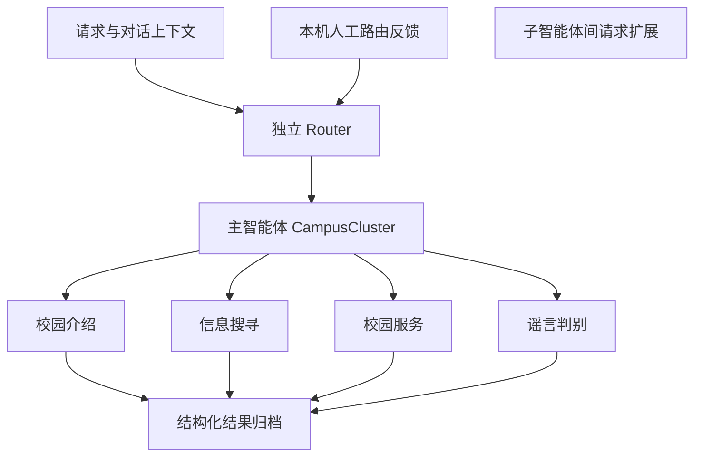

# 校园四子智能体框架

集群在 MainAgent 进程内异步编排四个校园角色。各角色按各自的注册表使用技能，校园服务接入 MINTA 的查询与办理。



主编排器只负责根据外部路由计划调度、传递所声明的依赖数据、管理超时与收集结果。四个子智能体之间没有预置调用策略。谣言判别不会默认请求信息搜寻；是否、何时请求其他角色，由以后接入的算法决定。

## 模块划分

| 模块 | 作用 |
| --- | --- |
| `agents/campus_introduction.py` | 校园介绍角色与后端插槽 |
| `agents/information_search.py` | 信息搜寻角色与后端插槽 |
| `agents/campus_services.py` | 校园服务角色与后端插槽 |
| `agents/rumor_assessment.py` | 谣言判别角色与结构化结论接口 |
| `registry.py` | 注册并校验恰好四个角色 |
| `routing.py` | 独立路由协议、角色自我介绍、模型选角与计划校验 |
| `routing_feedback.py` | 本机样本、人工评分与相似请求的角色建议 |
| `coordinator.py` | 主智能体调度与结果收集 |
| `interaction.py` | 子智能体间请求扩展接口 |
| `backends.py` | 接入已有 `ReliableAgent` 的可选适配器 |
| `subskills/` | 集中存放所有子智能体的技能实现 |
| `subskills/registry.py` | 统一登记技能及对应角色 |
| `skills.py` | 技能接口、注册表、参数校验和调用 |
| `capabilities.py` | 启动时盘点并发布 MCP 能力清单 |
| `contracts.py` | 请求、任务、结果、状态与配置契约 |

每个角色的 `knowledge_sources` 和 `allowed_tools` 默认均为空，`backend` 默认未绑定。来源名称只是配置槽，不会自动打开网址、加载本地文件或构建知识库。

## 路由单独替换

路由只需实现：

```python
async def route(request: ClusterRequest, catalog: tuple[AgentProfile, ...]) -> RoutePlan:
    ...
```

通过 `build_campus_cluster(router=...)` 注入，主编排器不依赖路由算法的实现方式。

独立构建的空框架默认使用 `ExplicitRouter`。指定 `request.targets` 时逐项派发，省略时返回 `needs_input`。云端 Runner 通过 `LLMRouter` 让 MainAgent 选择直接回答、澄清或委派，`targets` 是协作建议。子智能体交回核验结果，由 MainAgent 组织最终答复。`RoutePlan` 支持显式声明 `WorkStep.depends_on`。执行前检查重复步骤、未知依赖、循环依赖与步骤上限。

云端默认 `LLMRouter` 先保守判断问题是否依赖校园事实或业务。校园问题通过本机 MCP 的 `get_subagent_capabilities` 读取各角色的实际技能，再结合职责和角色介绍选角。MCP 不可用或清单和当前注册表不同，路由使用当前运行的注册表。无需校内资料的人际建议等通用问题由 MainAgent 直接回答。启用本机反馈后，`RoutingFeedback` 根据管理员标注，为相似问题提供派发角色、直接回答或先澄清的建议。 [本机配置和标注命令](../cloud/README.md#本机路由反馈)

同一消息有多项要求时，MainAgent 结合会话拆分问题，每项带着相关的日期、地点、对象和条件独立路由。同一子智能体可以接到多个不同问题。默认最多安排 8 个执行步骤，同时执行最多 4 项。依赖前一项结果的请求等待前置项完成。当一项缺资料或执行失败时，其余结果仍按提问顺序返回。办理事项继续使用确认流程。一条消息提出多项办理时，先交付查询结果，再请用户选定本轮要办理的一项。

## 子智能体间请求扩展

`interaction.py` 只保留以下接口，方法体抛出 `NotImplementedError`：

```python
class InterAgentLearningAlgorithm:
    async def propose_requests(self, task: AgentTask, reply: AgentReply) -> tuple[PeerRequest, ...]:
        ...

    async def observe(self, request: PeerRequest, reply: AgentReply) -> None:
        ...
```

`PeerRequest` 当前只描述发送角色、接收角色和请求文本，后续可按你的算法扩充。主编排器没有自动调用这两个接口，也没有实现请求选择、评分、学习、训练或递归协商。算法接入前，角色协作仅来自外部明确声明的计划。

## 空框架使用

```python
from main_agent.campus_cluster import AgentId, ClusterRequest, build_campus_cluster

cluster = build_campus_cluster()
result = await cluster.run(ClusterRequest(
    conversation_id="chat_001",
    query="框架检查",
    targets=(AgentId.CAMPUS_INTRODUCTION,),
))

assert result.status.value == "needs_configuration"
```

没有后端时返回 `needs_configuration`，不会产生虚构校园回答，也不会调用模型或业务工具。`conversation_id` 用于关联请求；当前模块不提供对话数据库或跨轮记忆持久化。

## 后续内容接入点

每个子智能体通过 `AgentBackend.run(task: AgentTask) -> AgentReply` 接入模型或远程服务。构造时使用：

```python
cluster = build_campus_cluster(
    backends={AgentId.INFORMATION_SEARCH: search_backend},
)
```

`AgentTask` 包含原始请求、调用方提供的历史、角色配置、证据和显式上游摘要。历史与任务数据在角色之间复制隔离；只有声明的直接依赖才会传递上游结果。上游摘要属于数据，不自动作为证据。证据 ID 在子任务输入中重新登记为 `input:<序号>` 和 `upstream:<步骤>:<序号>`，保留原文、来源、调用参数和有效期。

已有工具后端可通过 `ReliableAgentBackend(reliable_agent)` 接入核验流程。每个任务的工具白名单取角色配置与后端原有白名单的交集，内置只读补证器也受这份名单约束。

校园传闻、显著变化、突发或异常的校园消息交由「谣言判别」核实。该角色通过技能注册表使用校园谣言防控服务和校园日报取证。谣言判别回复具有 `RumorVerdict` 字段，支持 `supported`、`refuted`、`mixed`、`insufficient_evidence`。有确定性结论时需携带证据。使用 `ReliableAgentBackend` 接谣言角色时，需要提供 `rumor_verdict_parser`。

## 读取域名首页

`read_domain_page` 在四个角色的注册表中分别登记。传入公开域名即可读取 HTTPS 首页，例如 `{"domain":"example.org"}`。

成功时 `ToolResult.content` 是 JSON 字符串，包含规范化的 `domain`、最终的 `source_url`、`title`、分行纯文本 `text` 和截断标记 `truncated`。请求失败时返回 `domain` 和包含 `code`、`message` 的 `error` 对象。

技能提取静态 HTML 和纯文本，跟随最多 4 次 HTTPS 跳转，并对每一跳校验公网地址。读取上限为 512 KiB，正文最多返回 8000 个字符。页面内容作为外部资料使用。

## 校园街景点位

`campus_street_view` 仅登记给校园介绍角色。明确起点和终点的问路用 `start` 和 `destination` 规划步行路线，返回每段走法、距离和资料来源。也可传点位 ID、名称、别名或 WGS84 经纬度查询街景点位。点位内容通过云 API 提供。 [街景 API 与录入方式](../cloud/README.md#校园街景接口)

## MINTA 网关查询

`minta_gateway` 分别登记给校园介绍、信息搜寻、校园服务和谣言判别。它通过既有 `MintaGatewayClient` 调用模拟服务的 `/agent/tools` 和 `/agent/call`。技能仅开放下表的只读查询。

`minta_campus_status` 与 `minta_campus_action` 仅登记给「校园服务」。每次 MainAgent 启动会根据加载的角色和技能重新发布清单，并读取 MINTA 后端当前登记的动作。后续校园请求会刷新过期的后端清单。

「校园服务」的只读技能 `campus_timetable` 查询教室、场馆、校园和社团活动、课程或授课、个人日程及借书到期时间。MainAgent 将单项时段问题转成查询参数，再根据该子智能体返回的表格回答。比如「明天下午哪间教室至少空一小时」可传教室服务、日期、钟点范围、`available_only=true`、`min_minutes=60`。表格使用北京时间；教室可预约时段按当前开放规则和已确认的占用计算。

写入技能可在 `Skill.actions` 中登记 `SkillAction`，填写动作 ID、名称，以及各角色的必填信息和校验条件。启动清单由 `get_subagent_capabilities` 提供。MainAgent 为每轮校园请求筛选当前有处理器、后端已登记且账号角色匹配的动作。处理器在提交时再核对登录会话、具体资源、归属和凭据。能力清单只描述申请条件，办理结果以回执为准。 [问答指令](../cloud/README.md#校园应用与问答办理)

| `service` | `tool` |
| --- | --- |
| `gym` | `gym_list_venues` |
| `club` | `club_list_activities` |
| `library` | `library_list_books` |
| `classroom` | `classroom_list_rooms` |
| `schedule` | `schedule_query` |

`{"service":"schedule","action":"list_tools"}` 返回工具定义和参数 Schema。调用时传 `action:"call_tool"`、`tool` 和可选的 `arguments`。例如可用 `{"service":"schedule","action":"call_tool","tool":"schedule_query","arguments":{"student_id":"student-test-a","week":10}}` 查询本地已配置的模拟课表。

返回的 `ToolResult.content` 是 JSON 字符串。查询结果含 `source:"minta_simulation"`、`service`、`tool` 和 `data`。后端 HTTP 错误及无效回执以 `status:"error"` 记录。

默认连接 `http://127.0.0.1:19000`。服务地址用 MainAgent 的 `MAIN_AGENT_MINTA_URL` 配置，需认证的网关可由服务端配置 `MAIN_AGENT_MINTA_TOKEN`。在主管理器内运行 `start mintagw` 会启动网关和五个模拟后端。 [主管理器进程清单](../../../../MainProcessManager/README.md#进程管理)

## 检索校园资料库

`search_rag` 在子智能体中仅登记给「校园介绍」，用于查询校方公布的开放时间、制度原文及未接入的校务流程。传入 `{"query":"学生请假规定"}` 即可查找原文片段与来源。技能复用 MainAgent 的本机 MCP 检索，资料范围由 `MCP_RAG_SCOPE` 设置，默认 `campus`。

用户咨询已接入的预约、报名或借还等业务怎么操作时，「校园服务」根据当前账号可办理的动作提供步骤，MainAgent 在答复中提示可协助办理。实际提交仍需本轮的明确委托和相应的确认。

`search_campus_digest` 登记给「信息搜寻」和「谣言判别」。它按关键词、日期范围和来源查询校园日报收录的公告、加分活动、讲座和学校公众号内容，并返回发布日期、发布方和可用的原文链接。每份回执带索引版本和资料的新鲜度。 [校园日报接入](../../../CampusDigest/README.md)

`campus_wechat_articles` 也登记给「信息搜寻」和「谣言判别」。`{"action":"accounts","account":"学生会"}` 按名称查公众号，留空可逐页查看名录。`{"action":"search","account":"学生会","body":"报名截止"}` 用正文关键词查找文章，结果附命中片段和正文覆盖范围。用 `{"action":"read","article_id":"搜索结果中的 id"}` 获取正文。结果区分正文、已收录摘要和暂时无法读取，并返回发布时间及可用的原文链接。名录和正文查询均可传上页的 `next_offset` 继续读取。

## 校园传闻与异常变动核验

`assess_campus_rumor` 仅登记给「谣言判别」。停课、临时关闭、异常停水停电、规则明显变化和相互矛盾的校园消息进入此角色。追问只补时间、校区或适用人群时，使用同一会话的待核说法。常规办理流程、余量和本人预约仍按校园服务处理。

只询问怎样核对转发通知、从什么渠道找到原文时，由 MainAgent 提供查找步骤。

技能输入 `text` 和可选的原帖 `published`，取得判别服务器抽取的主张，并复用同一主张已保存的复核证据。还可读取已有监测主张的官方原文对照，证据不足时继续查校园日报。MainAgent 依据能对应到本次事件、有效时间和适用范围的证据组织最终答复。 [服务配置和启动](../../../CampusRumor/README.md)

## 添加子智能体技能

技能实现在 `subskills/` 下集中维护。在 `subskills/registry.py` 的 `SUBSKILL_ASSIGNMENTS` 中统一登记技能和负责的角色。四个子智能体各自从总表取得本角色的 `skill_registry`，每个后端只接入该角色获准调用的技能。

例如，在 `subskills/preview_query.py` 定义一个返回查询词的示例技能。

```python
from pydantic import Field

from ..skills import Skill, SkillContext, SkillInput


class PreviewInput(SkillInput):
    query: str = Field(min_length=1, max_length=200)


async def preview_query(context: SkillContext, args: PreviewInput) -> str:
    return args.query


PREVIEW_QUERY = Skill("preview_query", "预览检索关键词", PreviewInput, preview_query, read_only=True)
```

在 `subskills/registry.py` 导入 `PREVIEW_QUERY`，并在 `SUBSKILL_ASSIGNMENTS` 中加入下面这一项。

```python
from .preview_query import PREVIEW_QUERY

# SUBSKILL_ASSIGNMENTS 的一项
(PREVIEW_QUERY, (AgentId.INFORMATION_SEARCH,)),
```

- 一个技能只登记一次，可在同一项分配多个角色。统一注册表拒绝重名。非空的 `AgentProfile.allowed_tools` 和后端配置的 `allowed_tools` 可以进一步缩小调用范围。
- MainAgent 每次启动时盘点 `subskills/` 中的 `Skill` 定义，并根据实际注册表记录分配。尚未登记的定义在 MCP 清单中的 `registered_agents` 为空。模块加载时仅定义技能，联网和业务操作放到处理函数中。
- 参数类自动生成模型看到的工具 Schema。整批调用会先检查技能名和参数，随后才开始执行。处理函数接收已校验的参数对象和编排层提供的 `SkillContext`，其中包含角色、会话和步骤 ID。
- 处理函数可返回字符串或 `ToolResult`。需要记录业务成功、失败或证据有效期时使用 `ToolResult`。补证阶段只开放注册时标记了 `read_only=True` 且在补证白名单里的技能。
- `ReliableAgentBackend.from_skills(llm, reviewer, skills=registry)` 可为独立运行绑定模型和注册表。已有核验后端可用 `ReliableAgentBackend(reliable_agent, skills=registry)` 接入。自定义后端可用 `registry.bind(task)` 获取当前角色和任务专用的 `SkillClient`。
- 默认表在进程内复用，技能处理函数应通过当前 `SkillContext` 读取会话 ID。需要按用户或实例授权时，用 `CampusRunner.with_model(llm, skills_factory=...)` 为每次运行返回完整的角色技能表，并在处理函数中使用服务端提供的 `context.user_id` 和 `context.instance_id`。

## 调度与结果

- 默认最多 8 个步骤、4 个并发后端调用、单步骤 120 秒、整体 240 秒，均可用 `ClusterConfig` 调整。
- 依赖未完成的步骤返回 `blocked`。一个分支失败时仍保留其他独立分支的结果；存在已完成或部分结果时返回 `partial`。
- 输出按计划顺序返回，而非异步完成顺序。超时、错误和未配置状态不会被写成成功。
- 子任务异常只返回错误类型和状态码式原因，避免将上游异常原文作为回答。现有可信执行模块的快照会保留在步骤结果中。
- 总超时抛出 `ClusterTimeoutError`，其中 `results` 保存已可见的结果；外部取消继续传播，并清理正在运行的后端。
- 此处限制调度步骤、并发与时间；每个 `ReliableAgent` 后端仍使用自己的模型和工具预算，不声明跨后端共享 token 配额。

`Status.COMPLETED` 表示子任务返回了内容，不直接表示校园业务操作已经办理成功；真实办理状态仍由业务权限、工具回执及核验流程决定。

## 离线检查

在 MainAgent 根目录运行：

```powershell
.\.venv\Scripts\python.exe -B examples\campus_cluster_demo.py
.\.venv\Scripts\python.exe -B -m unittest discover -s tests -p test_campus_cluster.py -v
.\.venv\Scripts\python.exe -B -m unittest discover -s tests -p test_campus_skills.py -v
```

演示仅打印四个角色和待配置状态；测试使用脚本化后端，不接入真实模型或校园服务。
