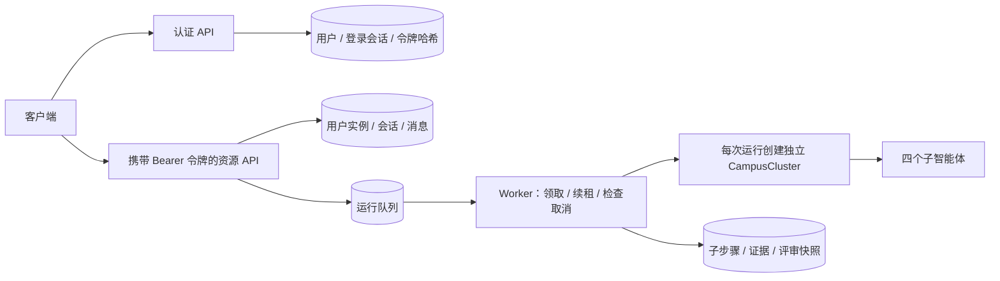

# 多用户云智能体服务

本模块实现数据库持久化的邮箱密码与校园 SSO 认证、用户实例管理、会话历史和后台任务队列。校园协议可选择 OIDC、CAS 或 SAML 2.0，配置与绑定流程见 [SSO 说明](SSO.md)。HTTP API 使用 Starlette，业务数据库使用 PostgreSQL 15+。四个校园子智能体通过 `CampusRunner` 接入，默认 Runner 支持可编辑的角色介绍和本机路由反馈。

## 资源与执行关系



- 邮箱注册和首次校园登录创建账户时，PostgreSQL 同时为该账号创建一个私有默认实例。每个账号最多 10 个实例，默认实例计入上限。每个实例保存独立会话。
- 每次请求产生一个主 `run`，四个子智能体写入它下面的 `run_steps`，不争用“会话最多一个活跃运行”的约束。
- 身份来自服务端认证结果，客户端只能提交问题和已声明的目标智能体，不能注入用户 ID、system 消息、工具白名单或模型地址。
- 持久状态全部在数据库中。多个 API/Worker 进程通过行锁和 `SKIP LOCKED` 协调，无需依赖单机字典或粘性会话。
- 数据库中的租约和每次领取生成的执行者 ID 共同限制提交权限。执行过期标记为 `failed / uncertain`，不会自动重放可能已产生业务副作用的任务。
- 暂停实例后拒绝新任务并暂停领取已有排队任务；已经运行的任务可以结束，也可以逐个取消。

## 完整认证流程

1. `register` 规范化邮箱并保存 Argon2id 密码哈希，发送邮箱验证令牌。重复注册返回同样的受理信息，不覆盖原密码。
2. 客户端将邮件中的一次性令牌提交给 `verification/confirm`。令牌从签发起有效 10 分钟，同类邮件重发间隔至少 60 秒。
3. `login` 验证密码、账户启用状态和邮箱验证状态，创建可管理的设备会话，返回访问令牌与刷新令牌。
4. 请求携带 `Authorization: Bearer <access_token>`。服务端验证令牌、会话和账号状态。业务访问还需绑定有效的校园统一身份并完成资料登记。 [校园身份绑定与资料登记](SSO.md#统一客户端流程)
5. 访问令牌默认 15 分钟，刷新令牌默认 7 天，登录会话绝对有效期 30 天。刷新时同时轮换两个令牌；旧访问令牌立即失效。
6. 重用已消费的刷新令牌会撤销整个设备会话，包括刚轮换出的令牌。客户端必须串行刷新，不能并发刷新或在超时后盲目重试旧刷新令牌。
7. 支持当前设备退出、全部退出、列出设备会话和撤销某一设备。
8. 忘记密码使用有效期 30 分钟的邮件令牌。登录后修改密码时，先提交当前密码申请邮箱令牌，再使用当前密码、同一登录会话的令牌和新密码确认。改密令牌有效 10 分钟。修改和重置密码会撤销全部登录会话。
9. 已验证的邮箱密码账号可以选择「记住我」。MainAgent 签发最多 30 天的恢复令牌，绑定到本次设备会话。浏览器经同源 BFF 恢复登录，退出或撤销会话会同时使恢复令牌失效。

新密码为 8–128 个字符，至少包含一个数字 `0–9` 和一个小写英文字母 `a–z`。注册、找回密码和修改密码适用此规则，登录按已保存的 Argon2id 哈希校验。Argon2id 参数为 19 MiB、2 次迭代、并行度 1。服务端只保存令牌的 SHA-256 哈希，邮件令牌通过请求体兑换。 [OWASP 密码存储](https://cheatsheetseries.owasp.org/cheatsheets/Password_Storage_Cheat_Sheet.html) · [会话管理](https://cheatsheetseries.owasp.org/cheatsheets/Session_Management_Cheat_Sheet.html) · [密码恢复](https://cheatsheetseries.owasp.org/cheatsheets/Forgot_Password_Cheat_Sheet.html)

认证限流计数和审计事件也落库，API 副本共享限制。限流包括登录、注册、邮件发送、令牌兑换和会话恢复。MainAgent 资源接口使用 Bearer 认证。网站使用同源 BFF 管理访问令牌、刷新令牌和浏览器会话。 [网站会话](../../../UserWebsite/README.md#网站会话)

## 安装与迁移

在 `server/MainAgent` 目录执行：

```powershell
.\.venv\Scripts\python.exe -m pip install -r requirements-cloud.txt
Copy-Item -LiteralPath .env.cloud.example -Destination .env.cloud
```

编辑 `.env.cloud`，填写运行角色 `agent_app` 的数据库连接和 SMTP 配置。已有数据库连接配置在项目 `DataBase/PostgreSQL/.env` 中；请将自己的连接写入新文件，服务不会自动读取管理员密钥。

迁移使用数据库所有者连接。通过环境变量临时设置 `CLOUD_MIGRATION_DATABASE_URL` 后运行：

```powershell
.\.venv\Scripts\python.exe -B -m main_agent.cloud migrate --env-file .env.cloud
```

迁移文件位于 `DataBase/PostgreSQL/migrations`，通过事务、版本表、校验和及数据库锁执行。旧四表中的会话归入用户自己的默认实例。升级已有实例的库时，保留会话和实例归属，以账号最早的实例作为默认；没有实例的账号会自动补齐。历史迁移保持原校验和，数据库所有者连接用于单独执行迁移和本机账号身份管理。

`011_campus_photos.sql` 为校园地图的地点照片和审核记录创建独立的 PostgreSQL 表。安装 `requirements-cloud.txt` 中的 Pillow 依赖后，上传接口会校验并重新编码照片，再保存到数据库。

`013_campus_photo_moderation.sql` 增加地点审核索引，并允许在线管理服务永久删除确认过版本的照片。

`015_calendar_subscriptions.sql` 为个人日历订阅保存账号归属、名称和凭据哈希。迁移后重启 MainAgent、统一接口管理器和网站即可启用日历同步。

`016_microsoft_todo.sql` 建立 Microsoft To Do 的授权事务和同步记录。MainAgent 启动后台同步前会检查这项迁移。微软访问令牌和刷新令牌用 `CLOUD_TODO_TOKEN_KEY` 加密后存到 PostgreSQL。

`017_personal_schedule.sql` 保存本人自定义事件，以及教室预约得到确认的起止时段。个人日程、ICS 和 Microsoft To Do 都可读取这两种记录。升级时需要编译新版 `sim-classroom`。 [重启步骤](../../../MainProcessManager/README.md#个人日程与教室分时预约)

校园资料和校务访问策略分别由 `009_campus_profiles.sql`、`010_campus_access_rules.sql` 创建。学生登记姓名、学号、学院和年级。教师登记姓名、工号和学院。资料绑定到统一身份，核验后的学院和年级用于校务准入。用户修改学籍或工籍字段后重新核验，修改称呼可直接生效。

`004_email_password_challenge.sql` 支持改密令牌和记住登录，并把存量邮箱验证令牌的最长有效期调整为签发后的 10 分钟。`005_user_roles.sql` 为现有账号补齐学生身份，并加入老师职称字段。`007_chat_turn_actions.sql` 添加重试、撤回和问答校务回执的关联。`008_chat_effect_tracking_default.sql` 让新版服务在提交轮次时明确标记回执可追踪，升级期间旧版服务提交的轮次仍按旧记录处理。先执行迁移，再启动新版 MainAgent。

迁移会向已有 `agent_app` 角色授权。新数据库需先由管理员创建运行角色及数据库、授予该角色 CONNECT；运行角色应为 `NOSUPERUSER NOCREATEDB NOCREATEROLE NOREPLICATION NOBYPASSRLS`。本版租户隔离由统一服务端查询实现，尚未启用 RLS。

## 学生和老师身份

普通账号的 `role` 为 `student` 或 `teacher`。邮箱和校园 SSO 创建的账号默认是学生。`academic_title` 是老师的可选职称，学生的该字段为 `null`。`GET /v1/me` 返回两项资料。后端鉴权在每次请求时从 PostgreSQL 读取当前身份。

设置好 `CLOUD_MIGRATION_DATABASE_URL` 后，在 `server/MainAgent` 的本地终端运行。下面以已存在的 `user@example.com` 为例。

```powershell
.\.venv\Scripts\python.exe -B -m main_agent.cloud set-user-role --email user@example.com --role teacher --title 教授
```

`--title` 提供四个高校教师职称选项。初级为助教，中级为讲师，副高级为副教授，正高级为教授。 [人社部与教育部高校教师职称指导意见](https://hudong.moe.gov.cn/jyb_xxgk/moe_1777/moe_1779/202101/t20210126_511116.html)

老师留空职称时省略 `--title`，网站称呼为「老师」。设回学生时使用 `--role student` 并省略 `--title`，会清除职称。身份修改记入账号审计，当前登录的用户刷新网页即可看到新的称呼。

## 启动

先在 `server/llmServer` 用该目录的虚拟环境运行 `server.py`，然后回到 `server/MainAgent` 启动云 API。

```powershell
.\.venv\Scripts\python.exe -B -m main_agent.cloud serve --env-file .env.cloud
```

云 API 默认端口是 `8081`。在同一工作区运行时，默认 Runner 使用 `llmServer/.env` 的 `LOCAL_PORT` 和 `LOCAL_API_KEY`，系统环境变量优先。由 `llmServer` 根据 `LLM_MODEL` 选择模型。独立部署时将 `MAIN_AGENT_LLM_SERVER_URL` 设为以 `/v1` 结尾的模型服务地址，并按需设置 `MAIN_AGENT_LLM_SERVER_API_KEY`。使用 `--port` 调整本地云 API 端口时，相应配置客户端和对外的 `CLOUD_PUBLIC_URL`。 [llmServer 配置说明](../../../llmServer/README.md)

默认 MainAgent 根据本轮问题和会话上下文保守判断任务范围，并负责最终回复。无需校园事实或校内操作的计算、翻译、写作、人际相处与情绪支持等问题由 MainAgent 通过 llmServer 直接作答。询问学校心理咨询预约、调宿流程或其他具体校内信息时，继续查资料并按需委派子智能体。校内事项的追问和含校园事实的混合问题也走校园核实流程。

对明确的续问，路由会把本轮补充合并到同一会话里用户原先提出的查询目标。比如先问今年国家奖学金的获奖名单，再补充「本科生」，系统按「今年本科生国家奖学金获奖名单」继续查询。MainAgent 和子智能体都用原始消息核对整理出的目标，再据此选取查询参数。具体校园信息仍以本轮证据为准。

部署者可将学校官网简介和其他获授权的资料导入 RAG。校园事实不确定时，MainAgent 和「校园介绍」子智能体都可调用 `search_rag` 查找原文和来源。最终回复只给相关结论、有效来源和必要的不确定性。资料不足时简短说明无法确认的事项，检索过程留在运行快照中。检索通过本机 MCP 访问 RAG，资料范围由 `MCP_RAG_SCOPE` 设置，默认 `campus`。 [MCP 配置](../../../mcpServer/README.md)

## 校园应用与问答办理

普通用户网站和问答共用同一套校务服务。PostgreSQL 迁移 `006_minta_operations.sql` 新增操作归属、幂等和回执记录，并记录问答的发起登录会话。校园服务子智能体办理前核对当前运行、账号和会话，MainAgent 根据实际回执答复。借还、报名和预约记录按登录账号隔离。明确的单项指令可以用一句话办理，例如 `帮我预约体育馆力量训练区`、`帮我报名活动名称`、`帮我借《馆藏书名》` 或 `归还《馆藏书名》`。名称须匹配现有馆藏或活动。 [校园应用接口](../../../UnifiedInterfaceManagement/README.md#minta-校园应用)

每次启动时从加载的技能登记和 MINTA 的实时工具清单建立可办理事项。校务请求使用最长缓存 5 秒的后端登记结果，结合当前账号角色发现可申请的动作和各自条件。通过主管理器 `start mintagw` 启动业务模拟服务，动作会在清单下一次刷新时出现。

问答里的办理计划统一由动作、对象和参数组成，例如 `{"action":"library.start","target":"馆藏书名","arguments":{"duration_days":"五天"}}`。MainAgent 结合当前会话和账号可用的动作生成计划。教室预约先按计划询问缺少的字段并展示待办。其他模型生成的校务计划由审核器核对意图与参数来源。校园服务子智能体接收计划后调用已登记的 `minta_campus_action`。

图书借期可选 1 至 14 天，未指定时为 7 天。借期从业务后端确认借出的时间起算，到期后仍占用馆藏副本，归还后才恢复可借。馆藏目录逐册显示匿名借期，只有借阅者能从个人记录归还。启用借期前先执行 PostgreSQL 迁移 `012_library_loan_periods.sql`，更新图书馆后端并重启 MainAgent。

图书馆应用的书架和 Agent 共用馆藏搜索。可以按书名、作者或书号搜索，按分类筛选，查询库存、借期和匿名进度。Agent 通过 `minta_campus_status` 读取，`library.view=catalog` 查询馆藏，`library.view=my_loans` 查询本人借阅、到期时间和已归还记录。借阅和提前归还继续通过 `minta_campus_action` 办理。

### 校务时段表

MainAgent 和统一接口均提供登录后的 `GET /v1/minta/timetable`。`service` 可取 `classroom`、`gym`、`activity`、`schedule`、`personal`、`library` 或 `my_loans`。`date` 和 `end_date` 是北京时间日期，范围含两端的日期，最多 31 天。`start_time` 和 `end_time` 可限制每天的查询钟点，`target` 可按名称或编号筛选。`available_only=true` 只查看可预约的教室和场馆，`min_minutes` 限制连续可用时长，`min_capacity` 限制教室容量。`page` 从 1 开始。

结果的 `rows` 包含具时区的 `starts_at`、`ends_at` 和状态。教室返回匿名占用和预约系统当前可用的空档，场馆返回实际发布的场地时段与余量。活动读取活动列表，个人日程读取当前账号的课程、确认报名、预约和自定义记录。匿名馆藏借期中的结束时间表示计划到期。学生课程沿用模拟课表，教师课程通过已核验工号读授课记录。`verified=false` 表示有时段无法核对。此接口读取现有服务的数据，已安装个人日程与分时预约迁移的环境可直接重启应用启用。

对于由模型识别的写操作，服务先解析具体资源并展示待办内容。MainAgent 根据同一会话窗口内的全部消息及后端待办，判断「确认」或「就按刚才的预约提交吧」这类回复。模型识别的确认经过一次语义审核，提交时沿用已展示的对象和参数。明确指令也可直接确认，教室预约回复「确认预约」，其他事项回复「确认办理」。「放弃预约」或「放弃办理」可以结束待办。新办理记录会取代前一项待办。提交时由业务服务检查账号、资源状态和所需凭据，MainAgent 依据业务回执回复。

社团登记人可用「恢复社团摄影社」或「恢复社团活动摄影社，活动名称：校园外拍」恢复归档。永久删除在校园应用或在线管理台内确认。发布活动由社团后端核对登记人权限和当前审核状态。

教室预约可以分多轮补齐教室、开始和结束时间。学生还要提供老师姓名和电话。MainAgent 结合会话历史及待办情况理解「帮我预约明天 14:00 至 16:00 的 A101」之类的说法，并在提交前展示北京时间时段。待办中遇到含糊的回复时先澄清。传给模型的会话历史会遮盖教师电话，确认提示只显示尾号。已提交的轮次重试时读取本轮已有的回执。

「可以帮我预约教室吗」这类自然表达会按会话语境识别，进入预约分支后按身份询问缺少的信息。学生需提供教室、老师姓名和电话号码，教师提供教室编号或名称，由本机服务核验本人有效电子凭据。教室凭据与已验证邮箱及已绑定的校园 SSO 身份关联。 [教师电子凭据](../../../../DataBase/TeacherCredentials/README.md)

体育馆预约按场馆、日期、北京时间时段和场地号确认。工作台显示当前登录身份，聊天可分轮补齐，再回复「确认预约」。教师和学生使用同一流程。预约提交时按场地时段重新校验余量。取消可使用预约记录编号，同一场馆有多条预约时可指定日期、时段与场地号。

社团登记用 `登记社团：摄影社，类别：文艺，简介：校园摄影`。登记人可用 `修改社团：摄影社，简介：新的简介`，或用 `发布社团活动：摄影社，活动：外拍，地点：南门，开始时间：2026-12-01 14:00，结束时间：2026-12-01 16:00，名额：20，简介：校园摄影`。也可从「校园应用 → 社团」使用表单。


同一工作区的 `llmServer` 使用官方 DeepSeek 上游时，核验阶段请求 JSON 输出。工具回执进入核验时保留原文与证据 ID。 [DeepSeek JSON 输出](https://api-docs.deepseek.com/guides/json_mode/)

默认只监听本机。生产环境设置 `CLOUD_DEVELOPMENT=false`、固定 HTTPS 的 `CLOUD_PUBLIC_URL`，并配置 SMTP；生产模式不允许关闭邮箱验证。HTTPS 可由反向代理终止，代理来源必须在 Uvicorn 的可信代理范围内，不能无条件信任外部 `X-Forwarded-*`。账户数据、邮件凭据、令牌和连接串不应进入访问日志；CLI 默认关闭 Uvicorn 访问日志。

每个 API 进程默认启动两个 Worker。也可以将 API 的 `CLOUD_WORKERS=0`，使用独立环境启动 Worker：

```powershell
.\.venv\Scripts\python.exe -B -m main_agent.cloud worker --env-file .env.cloud
```

独立 Worker 的 `CLOUD_WORKERS` 应大于 0。总并发为各进程 Worker 数之和，单用户默认最多 4 个排队或运行任务。数据库连接池每进程最多 12 条连接。API 提交后立刻返回 202，客户端通过运行查询接口获取结果，HTTP 断开不会丢失任务。「停止」采用协作式取消，自定义 Runner 必须正确传播取消信号。业务回溯走轮次撤回接口。

本地开发可先启动并检查数据库连接。发件账号或凭据未配置完整时，开启邮箱验证的注册、重发验证邮件和申请密码重置会返回 `503 mail_unavailable`。显式的本地开发可设置 `CLOUD_REQUIRE_VERIFIED_EMAIL=false`，用于测试无需邮件验证的注册。

## 邮件服务商

新用户使用邮箱密码注册时，服务端按下表精确匹配邮箱域名。其他域名返回 `422 email_provider_not_supported`。已有用户可按账号原邮箱登录和找回密码。校园 SSO 根据配置的学校身份源认证。

| 邮箱服务商 | 注册邮箱域名 | 发件预设与凭据 |
| --- | --- | --- |
| QQ | `qq.com` | `qq`，使用 SMTP 授权码。[QQ SMTP 参数](https://intl.cloud.tencent.com/zh/document/product/1266/71700) |
| 网易免费邮箱 | `163.com`、`126.com`、`yeah.net` | `163`、`126`、`yeah`，使用对应邮箱的客户端授权码。[网易 SMTP 参数](https://help.mail.yeah.net/faqDetail.do?code=d7a5dc8471cd0c0e8b4b8f4f8e49998b374173cfe9171305fa1ce630d7f67ac22b85ac2e7c90cd63) |
| Gmail | `gmail.com` | `gmail`，应用专用密码或 OAuth2。[应用专用密码](https://support.google.com/accounts/answer/185833?hl=en) · [Gmail SMTP 参数](https://developers.google.com/workspace/gmail/imap/imap-smtp?hl=en) |
| Outlook | `outlook.com`、`hotmail.com`、`live.com`、`msn.com` | `outlook`，OAuth2。[账号域名](https://support.microsoft.com/en-gb/outlook/add-your-outlook-com-account-in-outlook-for-windows) · [Outlook SMTP 参数](https://support.microsoft.com/en-us/outlook/pop-imap-and-smtp-settings-for-outlook-com) |

每套部署使用一个发件账号，为四家邮箱的用户发送验证和重置邮件。设置 `CLOUD_SMTP_PROVIDER` 和 `CLOUD_SMTP_FROM`，预设会选择主机、端口和 TLS。登录名默认取发件邮箱，也可通过 `CLOUD_SMTP_USER` 指定。使用授权码时，在本机 `.env.cloud` 填写 `CLOUD_SMTP_PASSWORD` 后重启服务。

```dotenv
CLOUD_SMTP_PROVIDER=qq
CLOUD_SMTP_FROM=your-address@qq.com
CLOUD_SMTP_PASSWORD=
```

Outlook.com 使用已取得发信权限的刷新令牌。授权时申请 `https://outlook.office.com/SMTP.Send` 和 `offline_access`，并填写 `CLOUD_SMTP_OAUTH_CLIENT_ID`、`CLOUD_SMTP_OAUTH_REFRESH_TOKEN`，机密客户端还需填写 `CLOUD_SMTP_OAUTH_CLIENT_SECRET`。 [微软 SMTP OAuth](https://learn.microsoft.com/en-us/exchange/client-developer/legacy-protocols/how-to-authenticate-an-imap-pop-smtp-application-by-using-oauth)

Gmail 使用 OAuth2 时设 `CLOUD_SMTP_AUTH=oauth2`，使用相同的客户端和刷新令牌配置项，授权范围为 `https://mail.google.com/`。服务使用刷新令牌续期，SMTP 通过 XOAUTH2 登录。 [Gmail XOAUTH2](https://developers.google.com/workspace/gmail/imap/xoauth2-protocol) · [Google 授权流程](https://developers.google.com/identity/protocols/oauth2/web-server)

## 本机路由反馈

默认 Runner 将四个角色的自我介绍放进主智能体的系统提示。创建服务账号可写的本机私有目录，将绝对路径填入 `.env.cloud` 的 `CLOUD_ROUTING_DATA_DIR`，然后启动默认 MainAgent 服务或 Worker 初始化 `routing.sqlite3`。Windows 上应将目录访问权限限于服务账号、本机管理员和系统账号，例如使用服务账号的私有 `AppData\Local` 目录。Linux 上由服务账号创建权限为 `0700` 的目录。各机器使用自己的本机数据目录。

新库的反馈学习默认关闭。登录在线 `/admin` 后打开「路由反馈」，可以查看采集趋势、实际结果与标注目标的分布、筛选样本、试算建议、管理标注和编辑角色介绍。标注可以选择子智能体或「不路由直接回答」，留空表示先澄清。标注一致率按实际结果与标注目标是否一致计算。历史样本参与总览和试算，采集趋势使用带采集日期的样本。

本机命令行使用同一份反馈库。进入 `server/MainAgent`，使用提升权限的 Windows 管理员终端或 Linux root 运行以下命令。

```powershell
$agentPython = '.\.venv\Scripts\python.exe'
& $agentPython -B -m main_agent.cloud.routing_admin --env-file .env.cloud introductions
& $agentPython -B -m main_agent.cloud.routing_admin --env-file .env.cloud set-introduction campus_services .\campus-services-intro.txt
& $agentPython -B -m main_agent.cloud.routing_admin --env-file .env.cloud enable
& $agentPython -B -m main_agent.cloud.routing_admin --env-file .env.cloud list
& $agentPython -B -m main_agent.cloud.routing_admin --env-file .env.cloud grade '<样本ID>' --score 2 --targets campus_services
& $agentPython -B -m main_agent.cloud.routing_admin --env-file .env.cloud disable
```

- 自我介绍文件使用 UTF-8。修改在下一次自动路由读取时生效。
- `list` 优先显示待评分的样本。评分为 1 到 5，评价实际路由的质量。`--targets` 支持一个或多个正确角色，`--direct` 指定主智能体直接回答，`--clarify` 指定先问清楚。再次评分会更新该样本的标签。
- 路由反馈依次尝试相同文本、字符匹配和本机句向量匹配。句向量使用已标注的脱敏样例，最多比较 32 个原型，同一标签最多取 8 个。最高相似度至少为 0.74，且领先其他标签至少 0.06 时才给出建议。一个多角色标注作为完整组合比较。主智能体结合本轮上下文自行判断，并可参考角色 ID、直接回答或澄清建议。
- 句向量复用本机 RAG 服务，默认连接 `127.0.0.1:8002`。RAG 使用其他端口时设置 `CLOUD_ROUTING_EMBEDDING_PORT`，设为 `0` 可仅使用文本匹配。RAG 暂不可用时继续按已有路由流程处理。开关状态与评分存于本机 SQLite，`disable` 同时停止采集和使用标签。 [RAG 服务启动说明](../../../../DataBase/RAG/README.md#http-检索接口)
- 路由样本保存最多 800 字符的脱敏请求、实际调度的角色或通用问题直接回答标记，以及用户是否显式指定目标。账号、会话标识、聊天历史和回复内容与样本分离。邮箱、电话号码、证件号和常见凭据格式会被替换，自由文本仍可能含有可识别信息。用 `delete <样本ID>` 删除样本及标签。最多保留 1000 条待评分样本，路由每次最多参考最近评分的 300 条。

## 校园街景接口

所有接口使用现有的 `Authorization: Bearer <access_token>`。同一份服务端配置同时用于 API 和校园介绍的 `campus_street_view` skill。 [本地导航数据接入](../../../../DataBase/CampusNavigation/README.md)

| 请求 | 返回 |
| --- | --- |
| `GET /v1/campus-view` | 校区信息、街景点位与路线摘要、可用于规划步行路线的 `walking_places` |
| `GET /v1/campus-view/routes/{route_id}` | 按路线顺序排列的点位，以及配置了的路线折线 `path` |
| `GET /v1/campus-view/points/{point_id}` | 点位坐标、拍摄信息和内容块 `content` |
| `POST /v1/campus-view/resolve` | 按点位 ID、名称、别名或经纬度查询，返回点位和 `detail_path` |
| `GET /v1/campus-view/media/{name}` | 读取被点位引用的照片、全景或视频 |

查询可传 `{"point":"图书馆"}` 或坐标参数，例如 `{"longitude":110.5,"latitude":35.5,"radius_m":40}`，也可以加 `route_id` 限定路线。空对象返回浏览入口。返回 `ambiguous` 时可展示 `candidates`，范围内没有点位时为 `no_match`。坐标统一为 WGS84。

查询步行路线时传 `{"start":"北门","destination":"图书馆"}`。`walking_route` 返回起终点提示、距离、分段方向 `steps`、地图折线 `path` 和资料来源。只填「校门」会得到多个候选。无连通路线时返回 `no_connected_route`。

内容块按 `kind` 区分 `text`、`image`、`panorama`、`video`、`link` 和 `custom`。媒体块的 `url` 是同服务的鉴权地址。浏览器可以通过携带令牌的请求取回媒体。自定义块返回 `component` 和 JSON `props`，客户端可按自己的组件映射渲染。

## API

除健康检查与认证入口外，均要求 Bearer 访问令牌。跨用户资源统一返回 404。

| 方法 | 地址 | 作用 |
| --- | --- | --- |
| GET | `/health`、`/ready` | 存活、数据库就绪 |
| GET | `/v1/auth/providers` | 当前可用登录入口与支持的校园协议 |
| POST | `/v1/auth/sso/campus/start`、`/v1/auth/sso/campus/finish` | 发起校园登录/绑定、兑换单次完成码 |
| GET / POST | `/v1/auth/sso/campus/callback` | 按所选协议处理校园回调 |
| GET | `/v1/auth/sso/campus/metadata` | SAML SP metadata（选择 SAML 时） |
| GET / DELETE | `/v1/auth/identities`、`/v1/auth/identities/{id}` | 查询、验证密码后解绑校园身份 |
| POST | `/v1/auth/register` | `{email,password,display_name?}` |
| POST | `/v1/auth/verification/request` | 重发验证邮件 `{email}` |
| POST | `/v1/auth/verification/confirm` | 验证邮箱 `{token}` |
| POST | `/v1/auth/login` | `{email,password,remember_me?}`，返回令牌对。记住登录时增加 `remember_token` 和 `remember_expires_in` |
| POST | `/v1/auth/refresh` | `{refresh_token}`，返回新令牌对 |
| POST | `/v1/auth/remember` | `{token}`，用有效的恢复令牌签发访问令牌，并返回剩余有效秒数 `remember_expires_in` |
| POST | `/v1/auth/password/request` | 请求重置邮件 `{email}` |
| POST | `/v1/auth/password/reset` | `{token,new_password}` |
| POST | `/v1/auth/password/change/request` | `{old_password}`，需要登录，向账号邮箱发送改密令牌 |
| POST | `/v1/auth/password/change` | `{old_password,new_password,token}`，需要申请令牌时的登录会话 |
| POST | `/v1/auth/logout`、`/v1/auth/logout-all` | 退出当前设备、全部设备 |
| GET / DELETE | `/v1/auth/sessions`、`/v1/auth/sessions/{id}` | 列出、撤销登录会话 |
| GET | `/v1/me` | 当前用户资料，含 `role` 和 `academic_title` |
| GET / POST | `/v1/instances` | 列出、创建实例 `{name}` |
| GET / PATCH / DELETE | `/v1/instances/{id}` | 读取、修改 `{name?,status?,is_default?}`，或永久删除 |
| GET / POST | `/v1/instances/{id}/conversations` | 分页列出（可用 `q` 搜索标题）、创建会话 `{title?}` |
| PATCH / DELETE | `/v1/conversations/{id}` | 修改标题 `{title}`，或永久删除 |
| GET | `/v1/conversations/{id}/messages` | 分页读取用户和最终回答 |
| POST | `/v1/conversations/{id}/runs` | `{query,targets?}`，必须带 `Idempotency-Key` |
| GET | `/v1/runs/{id}` | 运行状态、子智能体结果及本轮消息 |
| POST | `/v1/runs/{id}/cancel` | 取消排队或运行的任务 |
| POST | `/v1/runs/{id}/retry` | `{attempt}`，带 `Idempotency-Key`，重来当前会话的最新一轮 |
| GET | `/v1/runs/{id}/withdrawal` | 读取最新一轮的版本和按逆序排列的撤回步骤 |
| POST | `/v1/runs/{id}/withdrawal` | `{attempt,approvals}`，确认完整步骤后撤回最新一轮，成功返回 `204` |

`targets` 可选值为 `campus_introduction`、`information_search`、`campus_services`、`rumor_assessment`。默认 Runner 将它们作为协作建议，由 MainAgent 决定是否委派和选择哪些角色。

同一会话相同幂等键、相同输入返回原运行，不重复保存消息；同键不同输入返回 409；不同请求与已有活跃运行冲突也返回 409。用户消息与运行创建一起提交，最终回答、运行结束、子步骤及产物也一起提交。

会话列表按 `created_at,id` 倒序返回，包含排队或运行任务的 `active_run_id`。`cursor` 用于读取后续更早的会话。可选的 `q` 在当前实例内按标题做大小写不敏感的子串匹配，最多 200 字符。搜索时用相同的 `q` 请求后续页。消息默认取最新一页，页内按对话顺序返回，重来生成的回答紧跟原提问。`cursor` 用于读取更早消息。两者支持 `limit=1..100`，返回 `items,next_cursor`。会话的 `updated_at` 随消息写入或改名更新。Runner 的上下文只加载本轮之前同会话最近 40 条、总计不超过 60000 字符的用户和助手消息。已撤回的轮次会从会话和模型上下文中排除。

修改实例时提交 `is_default: true` 可将该实例设为账号的默认入口。删除默认实例时优先从其余已启用实例中选最近创建的一项。删除最后一个实例时会创建一个空的默认实例。删除实例或会话会永久移除其下属数据，包括消息、排队任务和运行产物。仍有任务在运行或正在撤回时返回 `409 run_in_progress`。删除成功返回 `204`。

Worker 通过数据库里的运行和租约确定所属会话。即使同一用户和同一实例下有多个会话并发运行，模型也只收到当前会话的历史和本次任务的证据。每次运行单独创建路由、子智能体后端和核验状态。

传闻仍未核实或子智能体执行失败时，MainAgent 会结合本轮和同一会话的历史说明正在核实的事项、能确认的信息和具体缺口。用户报告或补充仍待处置的校园暴力威胁时，优先提供安全建议。威胁的真伪仍须由可靠证据确认。 [北京市应急管理局应急指引](https://yjglj.beijing.gov.cn/art/2015/5/9/art_3940_243658.html)

`runs.status` 表示执行生命周期；`result_status` 表示业务交付情况。例如主编排正常结束，但后端未配置时，分别为 `succeeded / needs_configuration`，不能将它解释为任务完成或事实核验通过。

### 重来与撤回

重来和撤回只针对当前会话最新的可见轮次。旧轮次的请求返回 `409 turn_not_latest`，包括用户打开确认弹窗后又发出新消息的情况。撤回成功后，上一轮成为最新一轮。

重来保留提问和回答在原会话的位置，只读取原提问之前的上下文。内置问答的校务写操作沿用原回执。客户端使用本轮的 `attempt` 和新的幂等键发起重来。

撤回先读取 `{attempt,running,operations}`。每项 `operations` 提供 `id` 和用于确认的 `label`。逐项同意后，按原顺序将操作 ID 全量放进 `approvals`，无操作时传空数组。计划变化或回执无法确认时，服务端返回 `409`，客户端需重新读取并确认。提交通过后会停止本轮尚在执行的任务，再从最近一次操作开始撤销。

撤销取消、归还等操作时，会按原资源重新办理，仍需通过容量、账号和教师凭据校验。恢复记录与原记录关联。旧记录缺少可核实回执、后续变更冲突或回执未知时，保留本轮。已经撤销的步骤会记录结果，下次从剩余步骤继续。社团资料和活动的回溯需要同步更新 `sim-club`，教室预约的恢复需要新版 `teacher-credentials`。

## 接入业务后端

实现 `Runner.run(ExecutionContext) -> RunOutput`，或者向 `CampusRunner` 提供工厂。`ExecutionContext` 包含经服务端确定的 `user_id / instance_id / conversation_id / run_id`，可用来构造按用户授权的工具客户端。

```python
from main_agent.cloud.runner import CampusRunner
from main_agent.campus_cluster import build_campus_cluster

def create_runner(settings):
    def cluster_factory(context):
        # 在这里为该用户构建授权工具、ReliableAgentBackend 和独立路由。
        # 每次执行返回新集群；不要复用用户历史或可变的业务工具会话。
        return build_campus_cluster()
    return CampusRunner(cluster_factory)
```

将模块路径设置为 `CLOUD_RUNNER_FACTORY=my_cloud_backend:create_runner`。默认 Runner 使用 `CampusRunner.with_model(llm)` 为四个角色绑定生成、评审和修复模型，并读取各角色的 `skill_registry`。传入 `skills_factory(context)` 时，由工厂返回当前运行的完整 `SkillRegistry`，Runner 再按角色分别绑定。`router_factory(context)` 用于创建自定义路由。两个工厂都接收服务器提供的 `ExecutionContext`。自定义 Runner 可在自己的异步生命周期中使用 `connect_llm_server()`。 [子智能体技能接入](../campus_cluster/README.md#添加子智能体技能)

`run_artifacts` 保存证据、来源、到期时间、工具回执和评审快照等内部产物，当前不提供直接读取全部内部快照的公共接口。模型输出和用户反馈不会自动晋升为知识库事实。业务工具仍需根据 `context.user_id` 执行服务端权限校验。

## 验证与维护

```powershell
$env:CLOUD_TEST_POSTGRES='1'
.\.venv\Scripts\python.exe -B -m unittest discover -s tests -v
```

集成测试使用项目自带 PostgreSQL 程序，在随机本地端口建立独立临时集群。它不读取现有数据库凭据，不连接既有数据目录；测试结束停止并删除自己的临时目录。测试通过运行角色执行实际 SQL，邮件使用捕获器，模型使用脚本后端。

生产维护需按保留策略清理过期 `account_tokens`、过期会话（级联删除令牌）、超过窗口的限流记录和历史审计。已消费刷新令牌至少保留到对应会话失效，以保留重放检测能力。任务产物与消息包含用户数据，需纳入同一数据库备份与保留策略。当前没有内置邮件发送重试队列，发送失败会记审计，用户可以通过受限流控制的接口重发。
